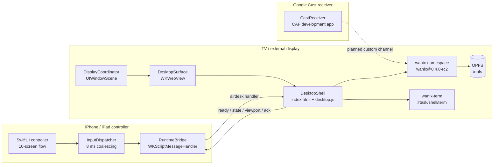
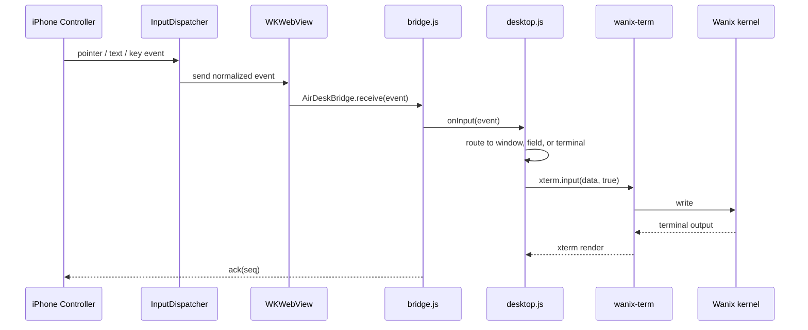
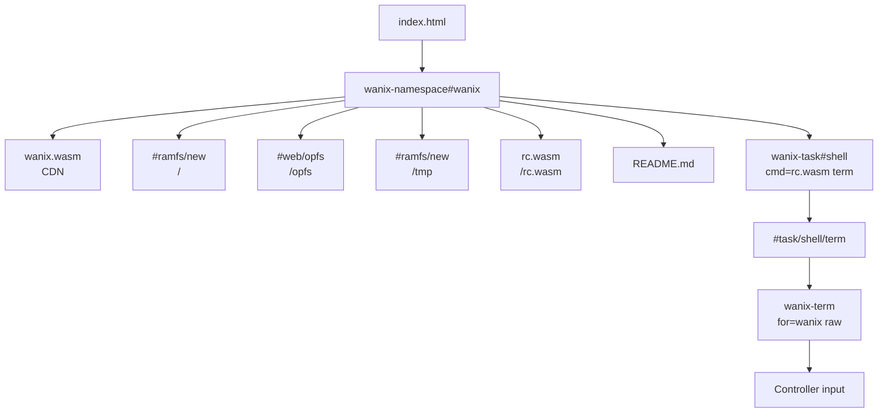

# AirDesk

AirDesk turns an iPhone or iPad into a precision remote for a macOS-style desktop running on a TV, external display, or Google Cast receiver. The desktop is a live web surface; the phone sends normalized pointer, scroll, keyboard, and text events through one bridge.

The primary runtime is Wanix, a Plan 9-inspired WebAssembly workspace. The desktop shell embeds a live Wanix namespace so Finder, Terminal, and Notes operate on the same virtual filesystem instead of a mock workspace.

## Runtime modes

| Mode | Engine | Pro | Status |
| --- | --- | --- | --- |
| Wanix Desktop | `index.html` + embedded `wanix-namespace` | No | Active development |
| Wanix Kernel | Standalone `wanix-live.html` kernel surface | Yes | Implemented |
| Puter | Remote Puter.js runtime | No | Adapter present, URL not configured |

## System architecture



## Input dataflow



Coordinates are normalized to `0...1`, so the same event stream works on a phone preview, a 4K TV, or a Cast receiver. The terminal uses `raw` mode so the shell receives Enter, Backspace, arrows, and control sequences directly.

## Wanix boot and filesystem



The namespace is mounted inside the desktop shell but hidden. Terminal windows create their own `wanix-term`, attach to the shared `#task/shell/term`, and then start the shell task. Finder reads the same root with `readDir`; Notes writes to `opfs/notes.json` and can open arbitrary files from the namespace. When OPFS is unavailable under `file://`, the shell falls back to `#ramfs/new` and snapshots `opfs/` to IndexedDB (with a localStorage fallback), restoring the workspace on the next load. A small file-URL worker shim converts Wanix's module worker into a self-contained classic worker, which Chrome and WKWebView require for `file://` pages.

## Repository layout

```text
AirDesk/
  App/                 App entry, routing, lifecycle
  Features/            Welcome, pairing, remote, keyboard, settings
  Session/             Session state machine and coordinator
  Display/             WKWebView surface and external display scenes
  Runtime/             Wanix, Puter, and runtime adapters
  Input/               Input schema, dispatcher, pointer ballistics
  Web/                 Swift-to-JavaScript bridge
  Security/            Origin and navigation policy
  Store/               StoreKit 2 entitlement manager
  Resources/
    DesktopShell/      index.html, desktop.js, apps.js, shell.css
    wanix-live.html    Standalone live kernel surface
  Tests/               Unit tests
CastReceiver/          CAF receiver development app
project.yml            XcodeGen project definition
```

## Build and test

```bash
cd ~/airdesk
xcodegen generate
xcodebuild -project AirDesk.xcodeproj -scheme AirDesk \
  -sdk iphonesimulator \
  -destination "platform=iOS Simulator,name=iPhone 16 Pro" \
  -configuration Debug \
  -derivedDataPath ~/airdesk/DerivedData \
  build CODE_SIGNING_ALLOWED=NO

xcodebuild -project AirDesk.xcodeproj -scheme AirDesk \
  -sdk iphonesimulator \
  -destination "platform=iOS Simulator,name=iPhone 16 Pro" \
  -configuration Debug \
  -derivedDataPath ~/airdesk/DerivedData \
  test CODE_SIGNING_ALLOWED=NO
```

## Security model

- File URLs are restricted to the bundled `DesktopShell` directory.
- Wanix CDN origins are allowlisted for the desktop and kernel surfaces.
- Remote runtime URLs must be HTTPS and match the configured origin.
- The bridge validates message envelopes and ignores mismatched session IDs.
- Readiness comes from the JavaScript runtime, never from page load.

## Current gaps

- Google Cast SDK integration and receiver registration are not complete.
- Android controller and display clients are not started.
- The Cast receiver must disable v86 and use a receiver budget below 512 MB.
- SharedArrayBuffer/COOP-COEP behavior under `file://` is unverified.
- OPFS is unavailable in Chrome under `file://`; the fallback snapshots `opfs/` to IndexedDB, but terminal writes outside `opfs/` are not persisted.
- Terminal commands that create missing files (`touch`, redirection, `write`, `cp`) fail with `No such file or directory`; Wanix's `fs.OpenFile` does not honor `O_CREAT` for missing files. Notes and the kernel API can still write to `opfs/`.
- The full 10-screen controller flow is still being implemented. The six TV modules now include Desktop, Finder, Terminal, Workbench, Notes, and Spotlight.
