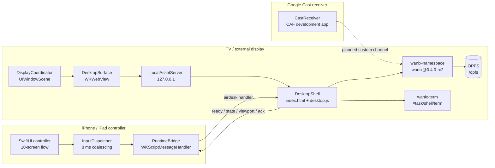
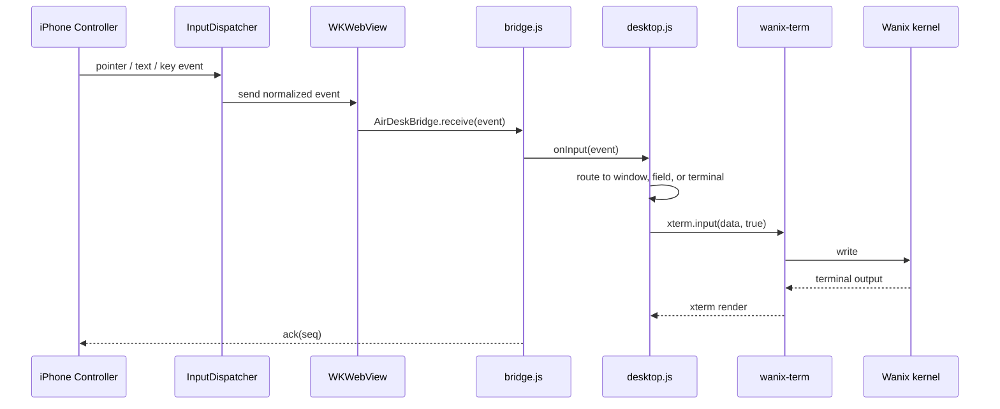
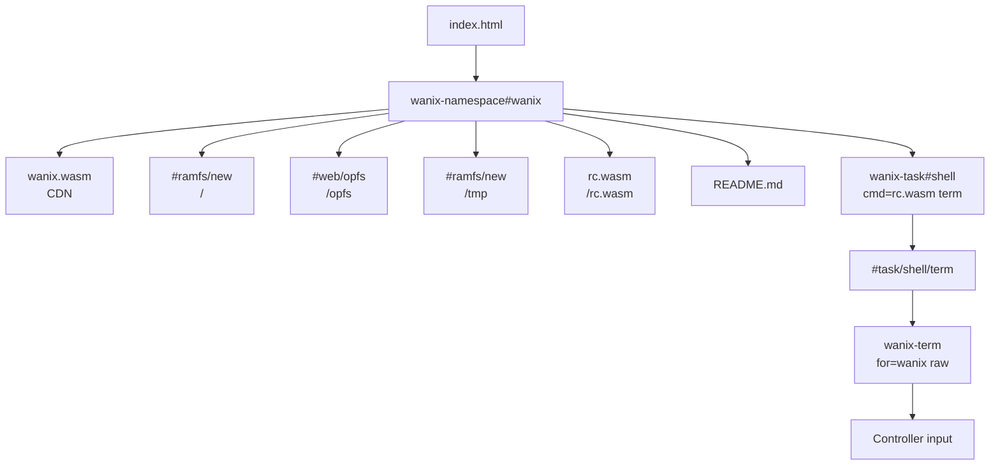

# AirDesk

AirDesk turns an iPhone or iPad into a precision remote for a macOS-style desktop running on a TV, external display, or Google Cast receiver. The desktop is a live web surface; the phone sends normalized pointer, scroll, keyboard, and text events through one bridge.

The primary runtime is Wanix, a Plan 9-inspired WebAssembly workspace. The desktop shell embeds a live Wanix namespace so Finder, Terminal, and Notes operate on the same virtual filesystem instead of a mock workspace.

## Runtime modes

| Mode | Engine | Pro | Status |
| --- | --- | --- | --- |
| Wanix Desktop | `index.html` + embedded `wanix-namespace` | No | Active development |
| Wanix Kernel | Standalone `wanix-live.html` kernel surface | Yes | Implemented |
| Puter | Remote Puter.js runtime | No | Adapter present, URL not configured |

## System architecture



## Input dataflow



Coordinates are normalized to `0...1`, so the same event stream works on a phone preview, a 4K TV, or a Cast receiver. The terminal uses `raw` mode so the shell receives Enter, Backspace, arrows, and control sequences directly.

## Wanix boot and filesystem



The namespace is mounted inside the desktop shell but hidden. Terminal windows create their own `wanix-term`, attach to the shared `#task/shell/term`, and then start the shell task. Finder reads the same root with `readDir`; Notes writes to `opfs/notes.json` and can open arbitrary files from the namespace. Terminal attachment has a 1.8 s watchdog and retries up to three times if the PTY handshake stalls.

The native app serves `DesktopShell` from a loopback-only `NWListener` at `http://127.0.0.1:<port>/` instead of loading `file://`. Every response carries `Cross-Origin-Opener-Policy: same-origin` and `Cross-Origin-Embedder-Policy: require-corp`, so `WKWebView` reports `crossOriginIsolated === true` and exposes `SharedArrayBuffer`. `LocalAssetServerTests` verifies cross-origin isolation, `SharedArrayBuffer`, OPFS file creation, and a worker `createSyncAccessHandle` write on the simulator.

`WKWebView` on iOS 18.6 exposes OPFS directory handles but not `FileSystemFileHandle.createWritable`, which Wanix's `#web/opfs` provider requires. The shell therefore checks for writable OPFS support and falls back to `#ramfs/new` with IndexedDB snapshot persistence when it is missing; the `opfs/` path still works for the terminal, Finder, and Notes. Native smoke testing confirms the fallback mount and terminal file operations.

`wanix-file-worker-fix.js` patches the embedded gojs worker on both loopback HTTP and `file://`: it creates missing files for `O_CREAT`, normalizes rc2 timestamp arguments, and wraps the Blob before Wanix starts. For `file://` it also inlines the `WanixHandle` module and converts the module worker into a self-contained classic worker, which Chrome requires. When OPFS is unavailable, the shell falls back to `#ramfs/new` and snapshots `opfs/` to IndexedDB (with a localStorage fallback), restoring the workspace on the next load.

If the desktop process terminates, `SessionCoordinator` retries with exponential backoff (four attempts, 0.5–8 s). If recovery is exhausted, `SessionRecoveryView` offers retry, display change, and diagnostics actions.

## Display and AirPlay

`DisplayCoordinator` supports two output modes, persisted in Settings:

- **Extended desktop** attaches and makes visible a `UIWindow` in the external `.windowExternalDisplayNonInteractive` scene, moves the Wanix surface there, and uses the display's native bounds. On AirPlay this asks iOS to leave system mirroring and render the desktop independently; the controller stays on the iPhone.
- **Mirror iPhone screen** intentionally leaves the external display scene without a window, which lets the system mirror the entire iPhone screen. AirPlay mirroring is started from Control Center; iOS does not provide a public API to start Screen Mirroring from inside an app. In this mode AirDesk renders the desktop full-screen on the phone with a collapsible floating remote, so the TV shows the desktop rather than the full controller.

When AirPlay mirroring does not create an external display scene, `DisplayCoordinator` detects the mirrored `UIScreen` and reports mirroring state so Connect, Settings, and the floating remote stay in sync. The idle timer is disabled while an external display or Cast session is active so the phone does not lock the desktop surface.

`AVRoutePickerView` is not used for this path because it routes media playback, not screen mirroring. A silent `AVPlayer` does not create an external display scene either. Extended desktop remains the better choice when iOS provides the external scene.

## Repository layout

```text
AirDesk/
  App/                 App entry, routing, lifecycle
  Features/            Welcome, pairing, remote, keyboard, settings
  Session/             Session state machine and coordinator
  Display/             WKWebView surface and external display scenes
  Runtime/             Wanix, Puter, and runtime adapters
  Input/               Input schema, dispatcher, pointer ballistics
  Web/                 Swift-to-JavaScript bridge, loopback asset server
  Security/            Origin and navigation policy
  Store/               StoreKit 2 entitlement manager
  Resources/
    DesktopShell/      index.html, desktop.js, apps.js, shell.css
    wanix-live.html    Standalone live kernel surface
AirDeskTests/          Unit tests
CastReceiver/          CAF receiver development app
scripts/               Local preview and simulator helpers
project.yml            XcodeGen project definition
```

## Build and test

```bash
cd ~/airdesk
xcodegen generate
xcodebuild -project AirDesk.xcodeproj -scheme AirDesk \
  -sdk iphonesimulator \
  -destination "platform=iOS Simulator,id=3B46FDF8-1482-4517-99F3-D6EF46A85133" \
  -configuration Debug \
  -derivedDataPath ~/airdesk/DerivedData \
  build CODE_SIGNING_ALLOWED=NO

xcodebuild -project AirDesk.xcodeproj -scheme AirDesk \
  -sdk iphonesimulator \
  -destination "platform=iOS Simulator,id=3B46FDF8-1482-4517-99F3-D6EF46A85133" \
  -configuration Debug \
  -derivedDataPath ~/airdesk/DerivedData \
  test CODE_SIGNING_ALLOWED=NO
```

DesktopShell sources live in `web/src`. Build and verify the committed bundle with Node 22:

```bash
cd ~/airdesk/web
npm ci
npm run check
npm run build
```

`npm run build` writes `AirDesk/Resources/DesktopShell/bridge.js` and its source map. Xcode still builds without Node; only edit the generated shell files through `web/src`.

## Local preview and simulator helpers

Serve the desktop shell from loopback for Chrome or Safari so COOP/COEP apply:

```bash
python3 scripts/dev-desktop-server.py
# open http://127.0.0.1:8123/index.html
```

Use the detached simulator helper when `simctl launch` or `bootstatus` stalls:

```bash
scripts/simctl-launch.sh "iPhone 16 Pro" com.airdesk.ios
scripts/simctl-launch.sh "iPhone 16 Pro" com.airdesk.ios "" -AirDeskAutoDemo
```

The helper boots, waits with a timeout, installs the Debug app, and launches it in the background. Extra arguments after the app path are forwarded to `simctl launch`.

Run the Chrome CDP smoke test after starting the loopback server and a headless Chrome instance with remote debugging:

```bash
"/Applications/Google Chrome.app/Contents/MacOS/Google Chrome" \
  --headless=new --disable-gpu --remote-debugging-port=9222 about:blank

uv run --with websockets python3 scripts/desktop-smoke-test.py \
  http://127.0.0.1:8123/index.html
```

The test verifies terminal startup, `touch`, `>`, `>>`, `cat`, `cp`, and OPFS reads and writes. It exits nonzero on a missing prompt or content mismatch.

Run the native smoke test after building the Debug app:

```bash
scripts/native-smoke-test.sh 3B46FDF8-1482-4517-99F3-D6EF46A85133
```

The helper boots the simulator, installs the app, launches it with `-AirDeskSmokeTest`, and polls `Documents/airdesk-native-smoke.json` without relying on `simctl get_app_container`. It exits zero only when the JSON reports `"ok": true`. The test checks the terminal prompt, root file writes, `cp`, and the `opfs/` fallback mount.

## Security model

- File URLs are restricted to the bundled `DesktopShell` directory.
- The native desktop is served from a loopback-only HTTP listener; navigation policy accepts plain HTTP only for loopback origins.
- Wanix CDN origins are allowlisted for the desktop and kernel surfaces.
- Remote runtime URLs must be HTTPS and match the configured origin.
- The bridge validates message envelopes and ignores mismatched session IDs.
- Readiness comes from the JavaScript runtime, never from page load.

## Backlog

Ordered by release risk and dependency. Google Cast work is paused by request.

### P0 - Release blockers

1. **Cast receiver registration and hosting**
   - The SDK 4.8.4 dynamic sender is linked, and session, input, and control channels are wired.
   - Still needed: registered receiver application ID (`AIRDESK_CAST_RECEIVER_APP_ID`), public HTTPS receiver, Cast Developer Console registration, v86 disabled, and receiver heap below 512 MB.
   - Validate discovery, session start/end, input latency, reconnect, and receiver reload on hardware.
2. **Display hardware validation**
   - AirPlay mirroring and extended desktop on Apple TV, wired displays, and 1080p/4K TVs.
   - Verify disconnect/reconnect, orientation, controller versus preview ownership, and recovery when the display changes mid-session.
   - AirPlay Screen Mirroring must be started from Control Center; iOS does not allow the app to launch it.
3. **StoreKit sandbox validation**
   - Monthly, yearly, family yearly, and lifetime purchase, restore, expiration, grace period, and Manage Subscriptions.
   - Confirm the Wanix Kernel Pro gate and entitlement refresh across launches.
4. **Release readiness**
   - Signing and provisioning, privacy manifest/local-network justification, app icons, versioning, archive, and TestFlight upload.

### P1 - Platform parity

5. **Android controller and display client**
   - Not started. First decide whether Android runs the Wanix shell locally or acts as a remote display client.
   - Reuse the normalized input schema, then build the Compose controller, WebView shell, and Cast parity.
   - The build host has Android Studio but no installed Android SDK or emulator yet; add those before implementation.

### P2 - Runtime hardening

6. **Wanix/WASI filesystem parity**
   - rc2 ignores `O_CREAT`, rejects integer `chtimes` timestamps, hardcodes zero inodes, and does not honor `O_APPEND`.
   - `wanix-file-worker-fix.js` patches the embedded gojs worker used by `rc.wasm`; standalone WASI workers still use upstream behavior.
7. **OPFS persistence**
   - WKWebView exposes OPFS handles without `createWritable`, so the shell falls back to `#ramfs/new` plus an IndexedDB snapshot.
   - The fallback snapshots `opfs/` only; terminal writes outside `opfs/` are not persisted. Chrome loopback HTTP still uses full OPFS via `scripts/dev-desktop-server.py`.
8. **AirPlay mirroring hardware validation**
   - `DisplayCoordinator` now detects a mirrored `UIScreen` when AirPlay does not create an external display scene. Validate detection, Preview, and disconnect handling on an Apple TV.
9. **Cast SDK upgrade path**
   - The SDK is pinned to 4.8.4. Version 4.8.6 references iOS 26 `UIGlassEffect` and does not link with the current Xcode 16.4/iOS 18.5 SDK; revisit after upgrading Xcode.

### P3 - Quality

10. **UI, accessibility, and CI**
    - Add UI smoke coverage for Connect, Settings, display-mode switching, and preview ownership.
    - Audit VoiceOver labels, Dynamic Type, and reduced motion.
    - Add CI for `xcodegen generate`, build, and tests.
11. **Documentation and screenshots**
    - Refresh screenshots for AirPlay modes and Cast setup.
    - Document the receiver registration checklist and the Android architecture decision.
