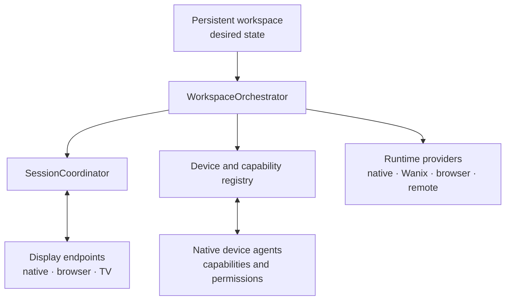

# AirDesk

[](https://github.com/amharik/AirDesk/actions/workflows/ios.yml)

AirDesk is building a distributed personal workspace. Its first implementation turns an iPhone or iPad into a controller for a macOS-style desktop running in a local Wanix WebAssembly workspace, displayed on the phone, a TV, an external display, or a Cast receiver.

The architecture is workspace-centric: the workspace is a persistent logical environment independent of devices, runtimes and display sessions. Devices contribute capabilities, runtime providers execute workloads, and display endpoints present the workspace without owning it. The current iOS app is the first implementation of that direction, not the completed fabric.

## Status

AirDesk is in active development. It builds and runs on iOS and iPadOS 17+, and the current input, desktop, terminal, and display paths are implemented. It is **not yet App Store-ready**: ADR-007 is still Proposed and the remaining Cast, external-display, performance, and distribution gates must pass first.

The revised architecture moves from a browser-first MVP to a five-release sequence: stable personal workspace, personal device fabric, universal display endpoints, distributed execution, and intent/collaboration. See the [release roadmap](docs/planning/release-roadmap.md).

| Area | Current state |
| --- | --- |
| iPhone / iPad controller | Working |
| Wanix desktop and WinBox windows | Working |
| WTerm + Ghostty terminal | Working, default |
| Remote SSH PTY | Working, opt-in |
| AirPlay / external display | Implemented |
| Google Cast receiver | Development app |
| Unit tests | 116 passing |
| iPad UI suite | Passing; 1 opt-in test skipped |
| Workspace model and orchestration | Architecture defined; not implemented |
| Device fabric and browser endpoint | Architecture defined; Release 2/3 |
| App Store release | Not yet |

## Features

### A real desktop, not a mock

- A macOS-style workspace with a menubar, Dock, Spotlight, desktop icons, context menus, and window controls.
- **Finder**, **Terminal**, and **Notes** share the same Wanix virtual filesystem.
- Windows are managed by WinBox behind an AirDesk-owned adapter, with focus, z-order, minimize, maximize, restore, close, drag, and resize.
- The desktop shell is served from a loopback-only asset server with a strict Content Security Policy. Wanix, WTerm, fonts, and terminal cores do not require a runtime CDN.

### Precise remote input

- Normalized pointer movement, tap, drag, scroll, text, and key events over one native bridge.
- Pointer ballistics and trackpad-style gestures for precise control on a phone or tablet.
- On-screen keyboard deck plus optional physical keyboard and mouse capture, with a clear capture/release state.
- Long-press drag mode and window drag mode for controlling a desktop from a touch screen.
- The same normalized event stream powers the phone preview and external display, and is the basis for Cast input.

### Terminal built for real work

- **WTerm** with the **Ghostty** core is the default terminal renderer.
- The local terminal attaches to the live Wanix shell and supports selection, copy/paste, scrollback, and transcript replay after a reload.
- A legacy `wanix-term` renderer remains available as an explicit rollback path.
- **Remote SSH** replaces the local shell with a native SwiftNIO SSH PTY. The app pins the server host key, stores the password in the Keychain, and defaults to `tmux new -A -s airdesk` so reconnects attach to the same remote session.
- Terminal window resize is bridged into the shell environment. See [current state and limitations](#current-state-and-limitations) for the current boundary.

### Flexible output

- **Extended desktop** sends the workspace to an AirPlay or external display while the phone remains a controller.
- **Mirror iPhone screen** renders the desktop full-screen on the phone and lets iOS mirror the whole screen to a TV.
- A separate **CastReceiver** development app is included for Google Cast work.
- A phone preview mode keeps the desktop visible while the floating remote stays available.

### Pro runtime

- The standalone **Wanix Kernel** runtime requires a Pro entitlement.
- Pro products are wired through StoreKit 2 and the local `AirDesk.storekit` configuration for development.

## Requirements

- iPhone or iPad running **iOS / iPadOS 17 or later**.
- A Mac for building the app.
- **Xcode 16.4** or later and **XcodeGen**.
- **Node.js 22** only when changing the bundled desktop shell.
- Optional: an AirPlay receiver, external display, Cast receiver, or an SSH host for the remote terminal.

## Quick start

AirDesk is currently built from source.

```bash
brew install xcodegen
git clone git@github.com:amharik/AirDesk.git
cd AirDesk
xcodegen generate
open AirDesk.xcodeproj
```

In Xcode, select the **AirDesk** scheme, choose your development team under Signing & Capabilities, select an iPhone or iPad, and run.

To build and test on a simulator without signing:

```bash
./scripts/ci-ios.sh
```

Override the default simulator with an Xcode destination:

```bash
AIRDESK_DESTINATION='platform=iOS Simulator,name=iPad Pro (11-inch) (3rd generation)' ./scripts/ci-ios.sh
```

## Using AirDesk

1. Launch AirDesk on your iPhone or iPad.
2. Choose the **Wanix Desktop** runtime and connect. A demo session is available for trying the interface without a second device.
3. Send the desktop to a display with AirPlay, an external display, or a Cast receiver.
4. Open **Preview Desktop** to use the workspace on the phone. Use the floating remote for pointer, keyboard, and window actions.
5. Use **Session → Remote Terminal** in Settings to point the terminal at an SSH host instead of the local Wanix shell.

### Remote terminal setup

Remote SSH is opt-in and uses the native SSH stack, not the web shell.

- Host, port, username, password, and pinned host key are entered in Settings.
- The default startup command is `tmux new -A -s airdesk`.
- Applying new settings restarts an open Terminal window so the new transport takes effect immediately.
- Turning the feature off returns the Terminal to the local Wanix shell.

## Runtime modes

| Mode | What it is | Access |
| --- | --- | --- |
| **Wanix Desktop** | Default local desktop with the embedded Wanix namespace | Free |
| **Wanix Kernel** | Standalone live Wanix kernel surface | Pro |
| **Puter** | Removed from the product direction | Code removal pending `PUTER-01`; not configured in this build |

## Current state and limitations

- ADR-007 (WinBox + WTerm) is **Proposed**. WinBox parity, WTerm conformance, and hardware qualification gates remain.
- Hardware and release gates still pending: Cast parity, external-display and safe-area behavior, 60 FPS at 1080p, signed offline install, Xcode 26 Cast SDK, and category-D parity.
- Terminal resize currently updates `COLUMNS` and `LINES` for subsequent shell commands. A running full-screen program does not receive a true PTY resize yet; that remains blocked on an upstream Wanix/`rc` change. Rotating the device alone does not resize the floating terminal window.
- Transcript replay restores terminal text after a reload, but the Wanix shell process restarts. Byte-exact PTY reconnect and live process resumption are not implemented.
- The real OpenSSH smoke test is opt-in because it needs a reachable SSH host and throwaway credentials. The default UI suite uses an in-process fixture.
- Puter removal is tracked as `PUTER-01`; its adapter and assets are still present in this build but are not configured.
- The workspace store, `WorkspaceOrchestrator`, runtime provider registry, native device agents and capability leases are architecture targets, not shipped features yet.
- The browser endpoint is Release 3 and is a presentation endpoint. It is not the first release or the workspace authority.

## Architecture at a glance

The target architecture separates the persistent workspace from the devices, runtimes and display sessions that realize it.



The workspace owns identity and desired state. The orchestrator resolves devices, capabilities and runtime providers, while the session coordinator manages controller attachment and presentation sessions. Neither a runtime provider nor a display endpoint becomes the workspace authority.

The current iOS implementation still centers on a `RuntimeBridge`, WKWebView desktop shell and local Wanix namespace. The phone sends normalized input through one bridge, and a native loopback asset server provides cross-origin isolation. See [ADR-001](docs/adr/001-multi-runtime-architecture.md), [ADR-005](docs/adr/005-display-and-transport.md), [ADR-007](docs/adr/007-winbox-and-wterm.md), [ADR-008](docs/adr/008-input-and-control-protocol.md), [ADR-016](docs/adr/016-workspace-domain-model-and-authority.md) and [ADR-017](docs/adr/017-workspace-orchestration-and-runtime-providers.md).

The browser endpoint is part of Release 3. It uses a local host agent and direct data connections but remains a presentation endpoint; see [ADR-014](docs/adr/014-browser-endpoint-topology.md), the [system overview](docs/architecture/system-overview.md) and the [release roadmap](docs/planning/release-roadmap.md).

## Development

### Project layout

```text
AirDesk/
  App/                 App entry, routing, lifecycle
  Features/            Welcome, pairing, remote, keyboard, settings
  Session/             Session state machine and coordinator
  Display/             WKWebView surface and external display scenes
  Runtime/             Wanix runtime adapter; Puter removal in progress
  Input/               Input schema, dispatcher, pointer ballistics
  Web/                 Swift-to-JavaScript bridge, loopback asset server
  Security/            Origin and navigation policy
  Store/               StoreKit 2 entitlement manager
  Resources/
    DesktopShell/      index.html, desktop.js, apps.js, shell.css, bundled assets
AirDeskTests/          Unit tests
AirDeskUITests/        UI and device tests
CastReceiver/          Google Cast receiver development app
scripts/               Build, CI, simulator, and smoke-test helpers
protocol/              FlatBuffers schema and language bindings
docs/product/          Product vision, principles and roadmap
docs/architecture/     Workspace, device, runtime and security architecture
docs/protocols/        ADFP module and transport documentation
docs/adr/              Architecture decision records
docs/planning/         Release roadmap and implementation plan
project.yml            XcodeGen project definition
```

### Desktop shell

The shell source lives in `web/src`; generated bundles are committed under `AirDesk/Resources/DesktopShell`.

```bash
cd web
npm ci
npm run check
npm run build
```

`npm run check` runs TypeScript, lint, tests, a committed-bundle freshness check, and the license policy. `npm run sbom` writes `web/build/sbom.cdx.json`. Bundled third-party notices live under `third_party/`.

### Protocol bindings

`protocol/airdesk.fbs` is the source of truth for input and control messages. Install `flatc` 25.12.19, then regenerate the checked-in Swift, TypeScript, and Rust bindings:

```bash
./protocol/generate.sh
cd web && npm run check
cargo test --manifest-path ../protocol/rust/Cargo.toml
```

### Tests and CI

- `AirDeskTests`: 116 unit tests covering input, runtime routing, SSH PTY, reconnect, terminal messages, and entitlements.
- `AirDeskUITests`: controller and desktop flows, terminal typing, resize, transcript replay, remote SSH, and WinBox lifecycle.
- `.github/workflows/ios.yml` runs the CI-equivalent checks on macOS through `scripts/ci-ios.sh`.

For a real OpenSSH smoke test on a Mac with `sshd` and Xcode:

```bash
scripts/real-ssh-smoke.sh
```

## Security and privacy

- The desktop asset server binds to loopback and enforces COOP/COEP and a strict CSP.
- No runtime CDN is required for Wanix, WTerm, fonts, or terminal cores.
- Remote SSH uses the native SwiftNIO stack with a pinned OpenSSH host key.
- Passwords are stored in the device Keychain. SSH credentials and private keys are not bundled into the web shell or committed to the repository.
- The `airdeskTerminal` bridge carries only PTY input, output, resize, and lifecycle messages.

## Documentation

- [ADR-001: Multi-runtime architecture](docs/adr/001-multi-runtime-architecture.md)
- [ADR-002: Gesture libraries and TypeScript](docs/adr/002-gesture-libraries-and-typescript.md)
- [ADR-003: Dependency admission and licensing](docs/adr/003-dependency-admission-and-licensing.md)
- [ADR-004: Runtime and execution baseline](docs/adr/004-runtime-and-execution-baseline.md)
- [ADR-005: Display and transport](docs/adr/005-display-and-transport.md)
- [ADR-006: Remote windowing](docs/adr/006-remote-windowing.md)
- [ADR-007: WinBox and WTerm](docs/adr/007-winbox-and-wterm.md)
- [ADR-008: Input and control protocol](docs/adr/008-input-and-control-protocol.md)
- [ADR-009: Workspace persistence and recovery](docs/adr/009-workspace-persistence-and-recovery.md)
- [ADR-010: AirDesk Fabric Protocol](docs/adr/010-airdesk-fabric-protocol.md)
- [ADR-011: Device identity, discovery and pairing](docs/adr/011-device-identity-discovery-pairing.md)
- [ADR-012: Capability advertisement and authorization](docs/adr/012-capability-advertisement-and-authorization.md)
- [ADR-013: Multi-transport and connectivity](docs/adr/013-multi-transport-and-connectivity.md)
- [ADR-014: Browser endpoint topology](docs/adr/014-browser-endpoint-topology.md)
- [ADR-015: Session ownership and multi-controller](docs/adr/015-session-ownership-and-multi-controller.md)
- [ADR-016: Workspace domain model and authority](docs/adr/016-workspace-domain-model-and-authority.md)
- [ADR-017: Workspace orchestration and runtime providers](docs/adr/017-workspace-orchestration-and-runtime-providers.md)
- [ADR-018: Native device agents and capability host ABI](docs/adr/018-native-device-agents-and-capability-host-abi.md)
- [ADR-019: Application model and lifecycle](docs/adr/019-application-model-and-lifecycle.md)
- [ADR index](docs/adr/README.md)
- [Product vision](docs/product/product-vision.md)
- [Product principles](docs/product/product-principles.md)
- [Product roadmap](docs/product/product-roadmap.md)
- [System overview](docs/architecture/system-overview.md)
- [Workspace domain model](docs/architecture/workspace-domain-model.md)
- [Workspace orchestration](docs/architecture/workspace-orchestration.md)
- [Device fabric](docs/architecture/device-fabric.md)
- [Device agent architecture](docs/architecture/device-agent-architecture.md)
- [Runtime architecture](docs/architecture/runtime-architecture.md)
- [Application model](docs/architecture/application-model.md)
- [Capability model](docs/architecture/capability-model.md)
- [Persistence and recovery](docs/architecture/persistence-and-recovery.md)
- [Security model](docs/architecture/security-model.md)
- [Deployment topologies](docs/architecture/deployment-topologies.md)
- [ADFP overview](docs/protocols/adfp-overview.md)
- [AD-RUNTIME](docs/protocols/ad-runtime.md)
- [AD-RESOURCE](docs/protocols/ad-resource.md)
- [Protocol versioning](docs/protocols/protocol-versioning.md)
- [Transport mapping](docs/protocols/transport-mapping.md)
- [Release roadmap](docs/planning/release-roadmap.md)
- [Workspace Fabric plan](docs/planning/workspace-fabric-plan.md)

## License

No license file is currently included in this repository. All rights are reserved unless a license is added.
