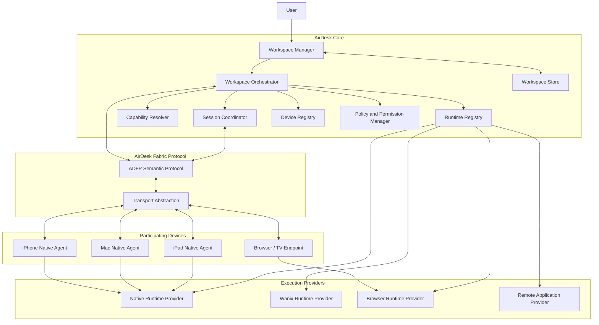

# System overview

AirDesk is organized around six domains. The boundaries are logical; early releases may run several components in one process.

## 1. Workspace domain

The workspace is the persistent logical environment. It contains identity, metadata, applications, desired instance state, layout, preferences, execution bindings, resource references, recovery information and optional synchronized state.

It is not a VM, desktop framebuffer, runtime process or display session. See `workspace-domain-model.md` and ADR-016.

## 2. Device fabric domain

The device fabric is the set of devices that can participate in a workspace. Native agents expose device capabilities and enforce platform permissions. See `device-fabric.md`, `device-agent-architecture.md` and ADR-018.

## 3. Runtime domain

Runtime providers execute applications and workloads. Initial providers are native, Wanix and browser execution. Remote providers are later. See `runtime-architecture.md` and ADR-004/017.

## 4. Presentation domain

The presentation domain renders a workspace on a display endpoint. It includes the shell, window manager, compositor, layout, focus, cursor state and display-specific adaptation. It does not own workspace state. See ADR-005/014/015.

## 5. Orchestration domain

`WorkspaceOrchestrator` coordinates workspace lifecycle, device and capability resolution, runtime selection, placement, application lifecycle, reconciliation and recovery. `SessionCoordinator` manages display sessions and controller attachment. See `workspace-orchestration.md` and ADR-017.

## 6. Identity and security domain

This domain manages device identity, pairing, trust, capability authorization, revocation, session credentials, resource policy and audit. Device identity and user identity remain separate. See `security-model.md` and ADR-011/012/018.

## Logical architecture

## Three planes

| Plane | Responsibility | Examples |
| --- | --- | --- |
| Control | Identity, discovery, policy, workspace coordination and lifecycle | Pairing, device registry, placement |
| Data | Inputs, files, media and application data | WebRTC, QUIC, WebSocket, IPC |
| Presentation | Visual composition and interaction | Shell, windows, cursor, display endpoint |

The control plane must not become a bulk-data bottleneck. The workspace store is not part of the presentation plane. Wanix is not the control plane.

## Authority boundaries

- Workspace identity and desired state belong to the workspace model.
- `WorkspaceOrchestrator` owns workspace lifecycle and placement.
- `SessionCoordinator` owns display sessions and controller attachment.
- Runtime providers execute; they do not own workspace state.
- Display endpoints present; they do not own workspace state.
- Native agents expose capabilities; they do not own workspace state.
- The coordinator is control-plane only.

## Documents

- `workspace-domain-model.md`
- `workspace-orchestration.md`
- `device-fabric.md`
- `device-agent-architecture.md`
- `runtime-architecture.md`
- `application-model.md`
- `capability-model.md`
- `persistence-and-recovery.md`
- `security-model.md`
- `deployment-topologies.md`
